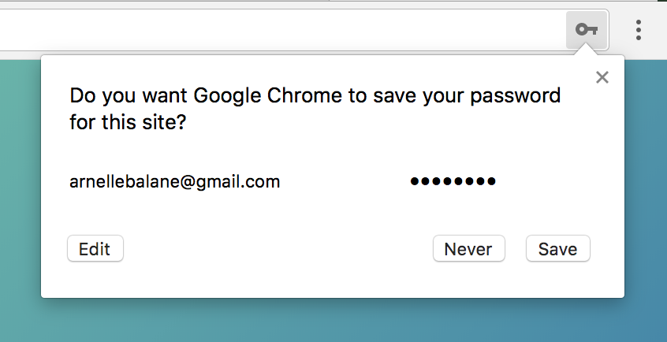
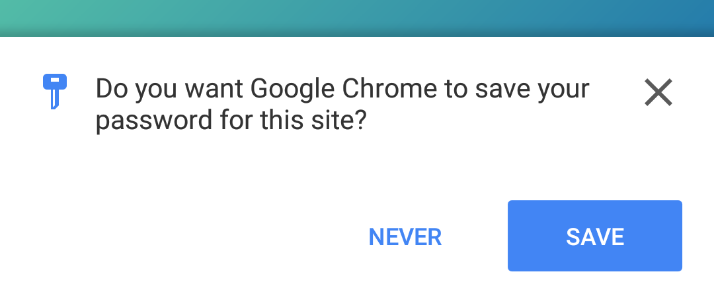
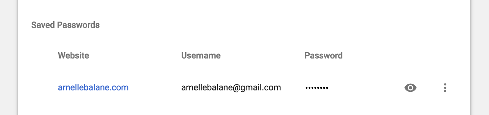
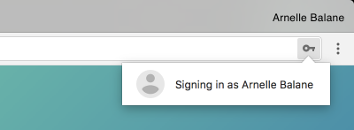
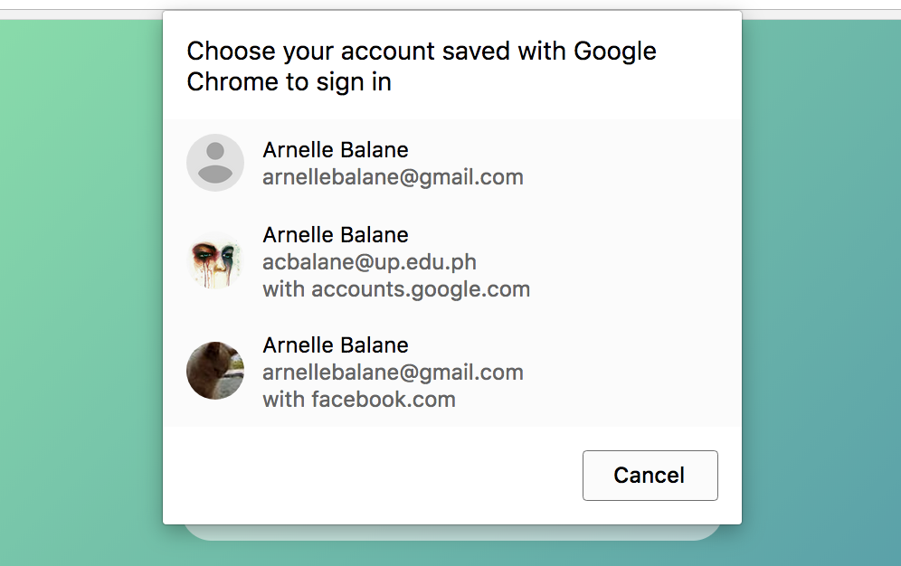
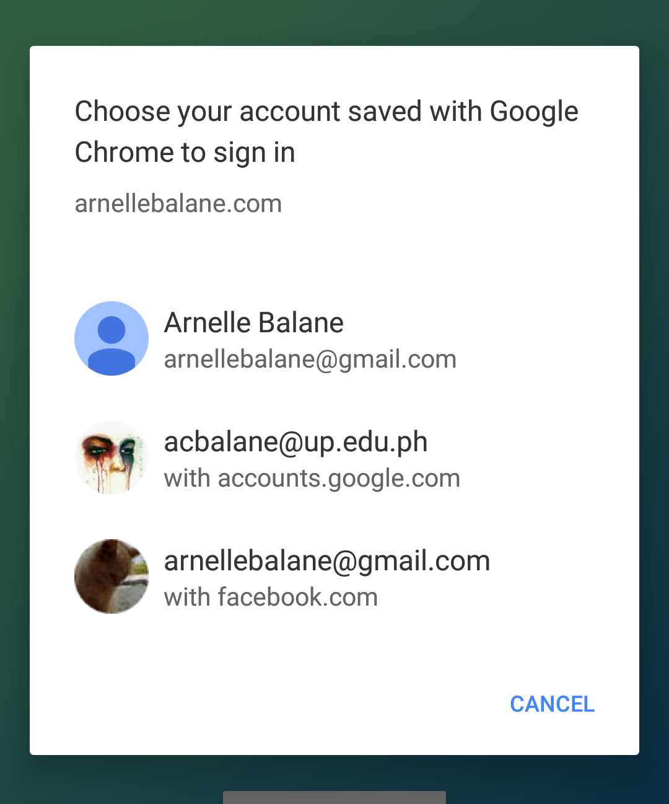

The Credential Management API is a browser API which provides programmatic
access to the browser's credential manager and helps users sign in to our apps
more easily and seamlessly. It allows web apps to store and retrieve user
credentials, and offers a lot of benefits:

1. **Reduces sign in flow friction**<br>
   Users can be automatically signed in back into the site when their session
   expires, or when they've already signed in and saved their credentials on
   another device.
1. **Allows one tap sign in with account chooser**<br>
   Users can see a list of accounts that they've used for the app via a native
   account chooser widget, and with a single tap, sign in using a specific
   account. This capability allows users to sign in without typing passwords.
1. **Stores and syncs credentials**<br>
   Our apps can store user credentials, be it a username/password combination
   or federated (i.e. using third-party providers) account details. These
   credentials are synced across devices by the browser.

I created [a demo application](https://credential-management-api.arnelle.dev/)
showcasing the Credential Management API in action, and here's a video of how
it works:

<div class="video-embed">
    <iframe
        width="560"
        height="315"
        src="https://www.youtube.com/embed/KuX2lqAeT5M?si=GLUbqkx83HedGSd-"
        title="YouTube video player"
        frameborder="0"
        allow="accelerometer; autoplay; clipboard-write; encrypted-media; gyroscope; picture-in-picture; web-share"
        referrerpolicy="strict-origin-when-cross-origin"
        allowfullscreen
    ></iframe>
</div>

If you are viewing the demo application, here's something cool to try out: sign
in to the app using any of the available sign in methods, and choose "Save"
when the browser asks you if you want to save your password or account. This
saves and syncs (assuming you have sync enabled in your browser) your
credentials across your other devices. Now get another device and open the demo
app. It should automatically sign you in. Awesome!

At the time of writing, this API is only supported on Chrome ≥51, Opera ≥45,
Android Browser 56, and Chrome for Android ≥59.

Now let's take a look at how to use the Credential Management API to create a
really cool authentication experience.

## Feature Detection

Before using the API, we need to check first if the browser supports it.

```js
if (navigator.credentials && navigator.credentials.preventSilentAccess) {
    // Credential Management API is supported!
}
```

There is an extra check for the presence of `preventSilentAccess` which checks
whether the browser supports the new Credential Management API (the old version
has `requireUserMediation` instead of `preventSilentAccess`).

## Storing user credentials

When the user signs in to our app, we need to store their credentials so that
it can be used later for auto-sign in as well as get synced across devices.
This is done by storing a `Credential` object to the browser using
`navigator.credentials.store()`.

There are two types of credentials depending on how the user signed in to our
app.

### Signing in with username/email and password

If the user signed in with a username/email and password, we need to store an
instance of `PasswordCredential`.

```js
const credentials = new PasswordCredential({
    id: 'arnellebalane@gmail.com',
    name: 'Arnelle Balane',
    password: 'myawesomepassword',
    iconURL: 'https://arnellebalane.com/avatar.png',
});
navigator.credentials.store(credentials);
```

Only the `id` and `password` options are required. What the value of the id
option is is entirely up to us: it could be an email address, username, etc. as
long as it identifies the user in our app.

### Signing in with federated account

If the user signed in with a federated account (i.e. sign in with Google,
Facebook, Github, etc.), we need to store an instance of `FederatedCredential`.

```js
const credentials = new FederatedCredential({
    id: 'arnellebalane@gmail.com',
    name: 'Arnelle Balane',
    iconURL: 'https://arnellebalane.com/avatar.png',
    provider: 'https://accounts.google.com',
});
navigator.credentials.store(credentials);
```

Only the `id` and `provider` options are required. The provider needs to be a
valid URL identifying the credential provider, and will be shown in the account
chooser as a hint for where the credentials were obtained from.

You can see from my examples that I am hard-coding credential values. You
wouldn't want to do that. The previous code snippets can be run at any point
after user has signed in, when we already have access to their profile.

**Note:** The Credential Management API does not replace existing
authentication flows and provide an alternative one. It actually supplements
existing ones by storing user credentials so they can perform the
authentication process a lot faster.

Upon calling `navigator.credentials.store()`, the browser will prompt the user
if they want to save their password or account.



<small style="display: block; text-align: center;">
    Save credentials prompt on desktop Chrome
</small>



<small style="display: block; text-align: center;">
    Save credentials prompt on Chrome for Android
</small>

Clicking on the "Save" button saves the user's credentials on the browser. We
can verify that the credentials have indeed been saved by going to
`chrome://settings/passwords`, which lists all saved passwords.



<small style="display: block; text-align: center;">
    chrome://settings/passwords
</small>

## Signing in users using stored credentials

We can sign in a user using a stored credential by first obtaining which
credential should be used. This can be done by calling
`navigator.credentials.get()`, which returns a `Promise` that resolves into a
`Credential` object that will be used to sign in the user or `undefined` if no
stored credentials are found.

```js
navigator.credentials.get({
    password: true,
    federated: {
        providers: ['https://accounts.google.com', 'https://www.facebook.com'],
    },
});
```

`navigator.credentials.get()` accepts an options object which tells it what
kinds of credentials it should look for. This object can have the following
keys:

- `password`: a `Boolean` indicating that the returned `Credential` instances
  should include user (i.e. not federated) credentials.
- `federated`: an object containing requirements for returned federated
  credentials, and can have the following options: `providers` and `protocols`,
  which are arrays of providers/protocols to search for.

The code snippet above will get all stored user credentials as well as
federated credentials from Google and Facebook. The `providers` strings need to
match the `provider` option specified when we created the `FederatedCredential`
instance. What happens next depends on how many credentials are found.

### No credentials found

In this case, `navigator.credentials.get()` resolves with undefined. We can
silently ignore it and let the user carry on with whatever they're doing in our
app.

### One credential found

In this case, `navigator.credentials.get()` resolves with that one credential
right away if user mediation is not required, allowing us to automatically sign
in the user with it. If user mediation is required, it will open the account
chooser showing just that one credential, which the user needs to explicitly
select in order for our app to obtain the credential.

What is user mediation? It is when some action requires the user's explicit
consent in order for it to be performed. In the Credential Management API, it
is expressed by the account chooser.

If the user gets automatically signed in, the browser lets them know about it:

<div class="image-centered">



</div>

<small style="display: block; text-align: center;">
    Auto-sign in on desktop Chrome
</small>


<small style="display: block; text-align: center;">
    Auto-sign in on Chrome for Android
</small>

### More than one credentials found

In this case, the account chooser will show with all the found credentials.
When the user selects an account that they want to use from the account
chooser, `navigator.credentials.get()` will resolve with the credential
corresponding to the selected account.

This is what the account chooser looks like:



<small style="display: block; text-align: center;">
    Account chooser on desktop Chrome
</small>



<small style="display: block; text-align: center;">
    Account chooser on Chrome for Android
</small>

Either one of the three scenarios above gives as a `Credential` object (unless
it's `undefined`). We then use this credential to sign in the user, using sign
in methods that we already have.

```js
navigator.credentials.get({ ... }).then(function(credential) {
    if (credential) {
        signIn(credential);
    }
});
```

Now we only want the user to be auto-signed in or display the account chooser
when the user is not currently signed in yet, so we check the user's
authentication status first before trying to get stored credentials.

```js
if (!isSignedIn) {
    navigator.credentials.get({ ... });
}
```

With this, our users now have an easy way of authenticating themselves in our
apps, by either being automatically signed in or with just a single tap on the
account chooser.

## Signing the user out

When the user signs out of our app, we'd like to make sure that they don't get
automatically signed back in again the next time they visit the app. For this
reason, there is a `navigator.credentials.preventSilentAccess()` method. We
need to call it upon signing out the user.

```js
function signOut() {
    // Do usual sign out stuff.
    navigator.credentials.preventSilentAccess();
}
```

This will make the API require user mediation the next time
`navigator.credentials.get()` is called, displaying the account chooser popup,
and thus preventing the user from being automatically signed in unless they
explicitly sign in themselves.

**Note:** At the time of writing, the [MDN docs](https://developer.mozilla.org/en-US/docs/Web/API/Credential_Management_API)
for the Credential Management API currently lists `preventSilentAccess()` as
`requireUserMediation()`. The latter is considered deprecated in the
[API's W3C Working Draft document](https://www.w3.org/TR/credential-management-1/),
and has been [renamed in Chrome](https://www.w3.org/TR/credential-management-1/)
in the version 60 release.

## Additional Notes

1. **Identifying federated provider URLs**<br>
   While reading about the Credential Management API, I wondered where the
   values `https://accounts.google.com` and `https://www.facebook.com` came
   from. Turns out that the Working Draft encourages every site to use the same
   identifier when referring to a specific federated identify provider. For
   consistency, federations must be identified by the origin that they use for
   sign in. Reference [here](https://www.w3.org/TR/credential-management-1/#provider-identification).
1. **Compatibility with the Fetch API**<br>
   The `fetch()` function from the Fetch API accepts an options object that
   could have a `credentials` property. You might be familiar with it if you've
   used `fetch()` and wanted to include cookies with the request. This property
   can also be set to a `Credential` object from the Credential Management API.
1. **Removing stored credentials**<br>
   Currently (at least in Chrome), the only way to to remove a stored
   credential is via the settings page, at `chrome://settings/passwords`.
   Nothing wrong with that though technically, in fact the Working Draft
   [states that it's fine](https://www.w3.org/TR/credential-management-1/#user-mediated-storage).
1. **HTTPS is required**<br>
   Even insecure localhost does not work, so while developing I had to use
   [ngrok](https://ngrok.com/). We could use self-signed certificates as well
   to serve localhost via HTTPS.

## Resources

Here are the resources that have helped me learn about the Credential
Management API:

- [The Credential Management API](https://developers.google.com/web/fundamentals/security/credential-management/)
  — a Web Fundamentals article from the Google Developers website.
- [Credential Management Level 1 W3C Working Draft](https://www.w3.org/TR/credential-management-1/)
  — for all the technical details about the API. I haven't really read the entire thing, but it's cool.
- [Credential Management API MDN Docs](https://developer.mozilla.org/en-US/docs/Web/API/Credential_Management_API)
  — might be outdated at the time of writing, but still a useful reference.

## Conclusion

I think this API is really awesome! As I noted earlier in this article, this
API supplements existing sign in solutions in our applications, giving users a
nice seamless experience without having to type in passwords. Browser support
might still be currently low, but it is a good enhancement to add to those that
support it.
