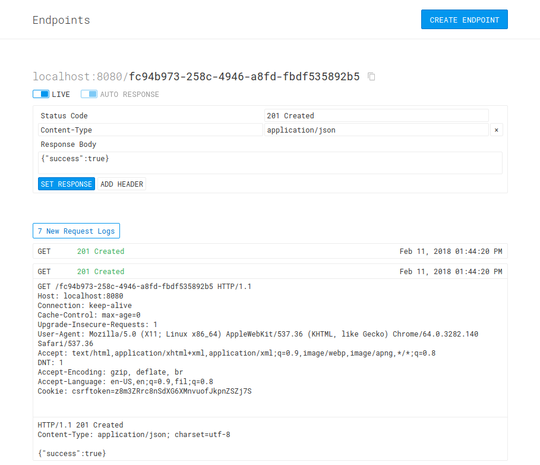

We recently built a side-project with [Emmanuel Lodovice](https://medium.com/@emmanuellodovice)
and [Aldrin Navarro](https://medium.com/@aldnav) named **Endpoints**, a Web
application that allows you to generate a mock endpoint where you can send HTTP
requests to, view a log of these requests, and set a customized HTTP response.
You can check out the live application at [endpoints.arnelle.dev](https://endpoints.arnelle.dev/)
or the source code at [GitHub](https://github.com/uncaughtxcptn/endpoints).

<small style="display: block; text-align: center;">
    Endpoints allows you to see a log of request logs and set a response
</small>

This post gives an overview of how the application's frontend was built and the
different technologies that we used. If you're interested in knowing how the
backend was built, you can read [Emmanuel Lodovice](https://medium.com/@emmanuellodovice)'s
article about it:

<blockquote>
    <a href="https://medium.com/uncaught-exception/building-the-backend-for-endpoints-project-837c906b8797">
        <strong>Building the backend for Endpoints project</strong>
    </a>
    

        We recently built a side-project with Arnelle Balane and Aldrin Navarro
        named Endpoints, a web application that allows you to generate mock
        endpoints that you can send HTTP requests to, view logs of these
        requests, and set customized HTTP responses.
    

    <small>medium.com</small>
</blockquote>

## JavaScript Framework

We used [VueJS](https://vuejs.org/) for our JavaScript framework. It is a
framework for building user interfaces, and what I like about it is that I
didn't have to learn any new language in order to use it (knowing HTML, CSS,
and JavaScript is enough to get started). This approachability enabled us to
start building the application right away. It also has a decent ecosystem of
libraries, plugins, and developer tools to make our lives easier.

We used VueJS' [Single File Components](https://vuejs.org/guide/scaling-up/sfc.html)
(SFCs). These components define their templates, styles, and JavaScript
behavior and other dependencies all in one file. This allows us to quickly
update a component's functionality since all the code related to it are all in
one place. SFCs also gives us scoped styling among other things, which
basically means that a component's styles are not going to affect the styles of
another components.

### Routing

The Endpoints app has three pages, and they are all structured as a Single Page
Application (SPA). To achieve this, we used Vue' official client-side router,
[vue-router](https://router.vuejs.org/). It takes care of identifying which Vue
component should be render based on the URL, and rendering that component
without reloading the page.

Vue-router also supports lazy-loading the components, which means that the
components are only downloaded by the browser only when they are the ones that
are going to be rendered. This is helpful for reducing our bundle size,
allowing the browser to download them faster and rendering our app faster. We
used this feature for the Vue components representing each page, which makes
Vue download the code for that component only when its URL is visited.

### State Management

We used [vuex](https://vuex.vuejs.org/guide/) to manage the states of our
application. It allowed us to keep all our state (available endpoints, request
logs, response data, etc.) in a single central location called a "store". These
states are then easily accessed by different components instead of having to be
passed as props from parent to child. Vuex also gives us mechanisms (mutations
and actions) to easily manipulate the states.

Using a vuex store as our single source of truth for our application state
makes it easier to synchronize data across different components, since we only
need to read or modify it in one location. Additionally, all our code that
interact with our backend are also placed inside the vuex store.

## Web APIs

Several Web platform APIs were used to implement the different functionalities
of the project.

### Fetch API

We used the [Fetch API](https://developer.mozilla.org/en-US/docs/Web/API/Fetch_API)
to programmatically send HTTP requests to our backend server. We used it to
either send data to the backend (e.g. a request to create a new endpoint) or
retrieve data from it (e.g. obtaining live status of an endpoint).

### WebSockets

One feature of the Endpoints app is that it shows a real-time log of HTTP
requests that your endpoint receives. In order to do this, we established a
[WebSocket](https://developer.mozilla.org/en-US/docs/Web/API/WebSockets_API)
connection between the browser and our backend server. This allows our backend
server to send request logs data to the browser as they arrive.

## Build Tool

We used [Webpack](https://webpack.js.org/) to build our frontend assets.
Webpack is a module bundler which takes different modules that you're using in
your application (e.g. stylesheets, images, JavaScript files, etc.), does some
processing on them, and then outputs a single file (or multiple files,
depending on the setup) containing these modules.

Webpack uses "loaders" to process modules, and there are different loaders for
processing specific types of modules. In the case of the Endpoints app, here
are the ones that we used:

- [vue-loader](https://github.com/vuejs/vue-loader) for processing Vue's Single
  File Components.
- [style-loader](https://github.com/webpack-contrib/style-loader) and
  [css-loader](https://github.com/webpack-contrib/css-loader) for processing
  stylesheets.
- [url-loader](https://github.com/webpack-contrib/url-loader) which inlines
  small assets (e.g. images, etc.) within the module that uses them.

### Code Splitting

I mentioned earlier that we only load Vue components only when its URL. In
order to do this, we needed split the code for these components out of the main
bundle and into their own smaller bundles, which are then going to be the ones
that are lazy-loaded at the appropriate time. Using vue-loader automatically
does this for us.

### Production Build

We performed additional steps in order to optimize our assets for production.
We minified the bundles that we serve in production using the
[UglifyJSPlugin](https://github.com/webpack-contrib/uglifyjs-webpack-plugin)
for Webpack. But we only do this when `NODE_ENV=production` is set in order to
not slow down development builds.

---

So that's the quick overview of how we built the frontend part of the Endpoints
project. We tried to keep the setup and configurations as minimal as possible,
and I think we did a decent job at doing that. You are welcome to dig deeper
into the code in the [GitHub repository](https://github.com/uncaughtxcptn/endpoints).

Thanks for reading!
