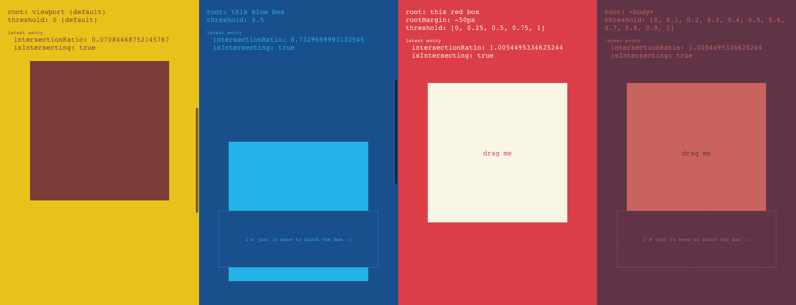
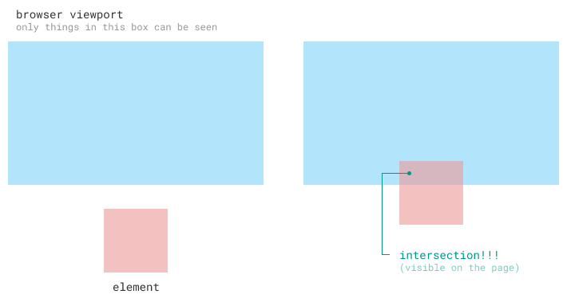
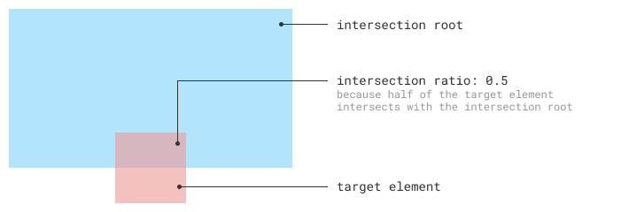
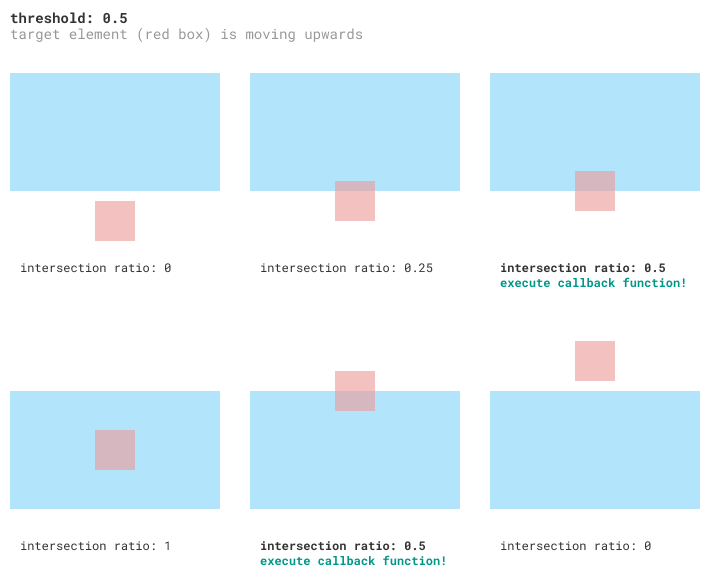
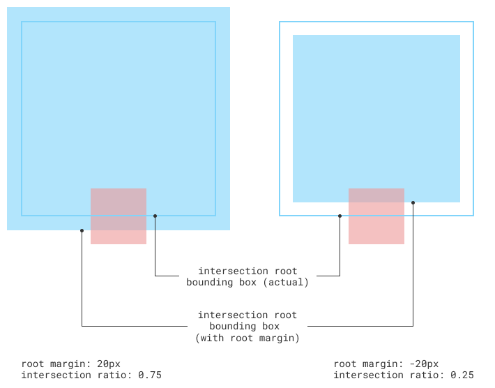
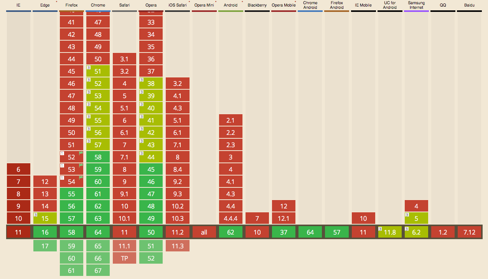

The Intersection Observer API is a Web platform API that allows for observing
changes to how much of a target element's area intersects with that of an
ancestor element or the viewport. The need for such information has a lot of
use cases, such as implementing lazy-loading and infinite scrolling, just to
name a few.

It's been historically difficult to obtain such information, and common
solutions oftentimes hurt the page's performance, but the Intersection Observer
API changes all of that. This article aims to give an introduction on how the
API works as well as how to use it.

## Why "Intersection"?

I've wondered for a while why the API is called _Intersection_ Observer, when
what it does is basically report changes on how much of an element's area is
visible inside an ancestor element or the viewport. Eventually I came to
realize what it actually means and this is how I like to visualize it:



Think of the browser's viewport and the target element as their own boxes. The
target element box is still somewhere at the lower part of the page and
therefore not yet visible. As you scroll down, the target element box moves up,
until eventually it overlaps ("intersects"!) with the the viewport box. Only
then does the target element become visible on the page. The amount of this
overlap or intersection is what the Intersection Observer API observes changes
on.

## Terminologies

Before we begin, here are definitions of some terminologies that are used a
lot in the rest of the article:



1. **Target Element.** This is the element whose intersection with an ancestor
   element (or the viewport) we want to observe.
1. **Intersection Root.** The ancestor element or the viewport in which we will
   be measuring the target element's intersection against.
1. **Intersection Ratio.** How much of the target element intersects with the
   intersection root. It is expressed as a value between `0` and `1`, inclusive,
   where `0` means the two don't intersect at all and `1` means the target element
   completely intersects with the intersection root.

## Creating an Intersection Observer

An Intersection Observer is created through the
[`IntersectionObserver`](https://developer.mozilla.org/en-US/docs/Web/API/IntersectionObserver/IntersectionObserver)
constructor. It accepts a callback function which it executes when it has
intersection changes that it wants to report. Then we call its `.observe()`
method to start observing a target element.

```js
const observer = new IntersectionObserver(function (changes) {
    // do something with the changes
});
observer.observe(targetElement);
```

By default, the Intersection Observer API uses the viewport as the intersection
root, and only executes the callback when the target element enters and exits
the viewport.

### Specifying an intersection root

If we want to use an ancestor element as the intersection root instead of the
viewport, we can do so by passing an options object as the second argument to
the `IntersectionObserver` constructor, and specifying the `root` property.

```js
const intersectionRoot = document.querySelector('#ancestor');
const observer = new IntersectionObserver(
    function (changes) {
        // do something with the changes
    },
    {
        root: intersectionRoot,
    },
);
```

## Thresholds

A threshold is a value in which the Intersection Observer will execute the
callback function **whenever the intersection ratio reaches that value**
(either as it increases or decreases), and is also expressed as a value between
`0` and `1`, inclusive.



The Intersection Observer uses a default threshold value of `0`, which is why
it only executes the callback function when the target element enters (i.e.
crosses the intersection ratio of `0` as it starts to become visible) or exits
(i.e. crosses the intersection ratio of `0` as it finally fully disappears) the
intersection root.

### Specifying thresholds

We can let our Intersection Observer use a different threshold value by passing
a `threshold` property in the options object.

```js
const observer = new IntersectionObserver(
    function (changes) {
        // do something with the changes
    },
    {
        threshold: 0.5,
    },
);
```

The example above executes the callback function every time the target
element's intersection ratio crosses `0.5`. It is also possible to set multiple
threshold values by passing an array of `threshold` values.

```js
const observer = new IntersectionObserver(
    function (changes) {
        // do something with the changes
    },
    {
        threshold: [0, 0.25, 0.5, 0.75, 1],
    },
);
```

The example above executes the callback function when the target element
enters/exits the intersection root (i.e. intersection ratio of `0`), then again
when its intersection ratio crosses `0.25`, then `0.5`, etc.

## The Callback Function

The callback function, when executed, is passed an array of entries, each an
instance of [`IntersectionObserverEntry`](https://developer.mozilla.org/en-US/docs/Web/API/IntersectionObserverEntry).
This is an array because the Intersection Observer object can be used to
observe multiple target elements, so it just reports intersection changes for
these multiple elements together.

Each `IntersectionObserverEntry` object has the following helpful properties:

- `boundingClientRect` and `rootBounds`, the positions and dimensions of the
  target element and the intersection root respectively.
- `intersectionRect`, the position and dimension of the rectangle representing
  the portion where the target and intersection root intersect.
- `intersectionRatio`, the intersection ratio value at that point.
- `isIntersecting`, whether the target element currently intersects with the
  intersection root or not.

## Root Margin

The rectangles that are used to compute the intersection ratio are based on the
bounding boxes of both the intersection root and the target element. However,
it is possible to adjust the intersection root's rectangle by setting
**root margins**.

We can expand the rectangle's dimensions by setting a positive root margin, and
shrink it by setting a negative root margin.



Root margins can be specified using a syntax that is similar to setting CSS
margins, e.g. `10px 10px 10px 10px` or `10px`, which allows us to customize the
bounding box dimensions on all sides, or just on some specific sides.

### Specifying a root margin

By default, the root margin is set to `0px 0px 0px 0px`. If we want to specify
a different root margin, we can do so by passing a `rootMargin` property in the
options object.

```js
const observer = new IntersectionObserver(
    function (changes) {
        // do something with the changes
    },
    {
        rootMargin: '10px',
    },
);
```

## Conclusion

So that's about it for the Intersection Observer API. I made
[a little demo](https://intersection-observer-api.arnelle.dev/) where you can
check out the API in action by interacting with a few elements on the page.

In terms of browser support, it is supported on the latest versions of Edge,
Firefox, Chrome, and Opera, as well as on several mobile browsers.



<small style="display: block; text-align: center;">
    <a href="https://caniuse.com/intersectionobserver">https://caniuse.com/intersectionobserver</a>,
    Feb 25, 2018
</small>

The Intersection Observer API provides a really simple, performant, and
easy-to-use solution to a common need in modern Web applications, and I'm glad
that this has been added to the Web platform.
