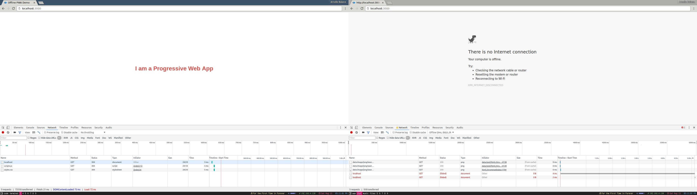
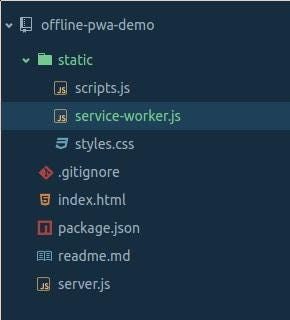
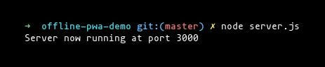
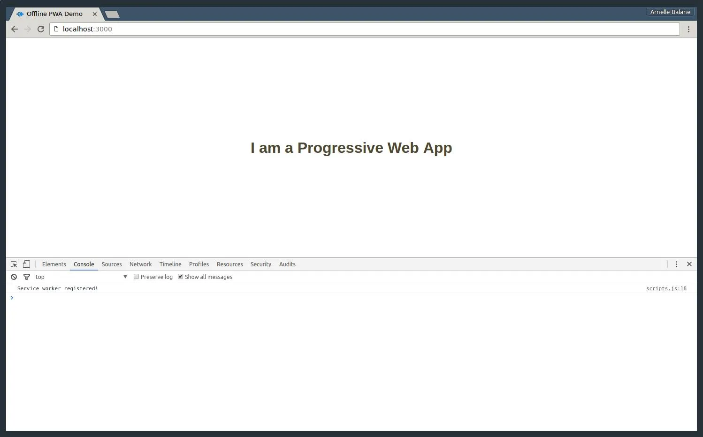
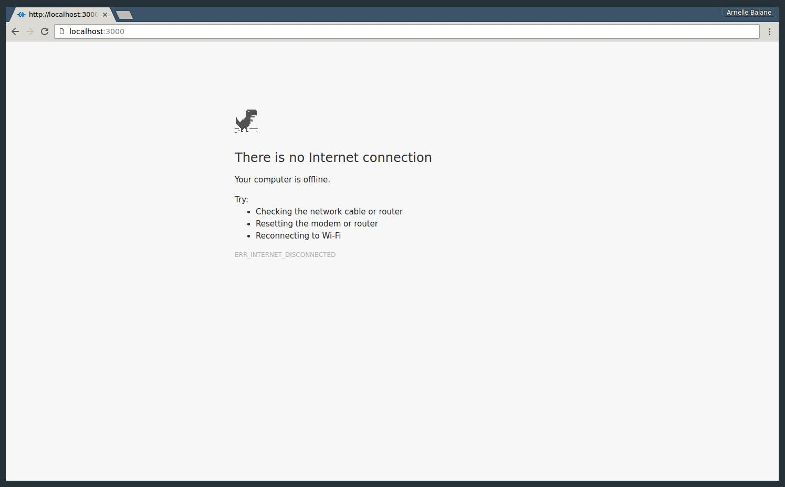
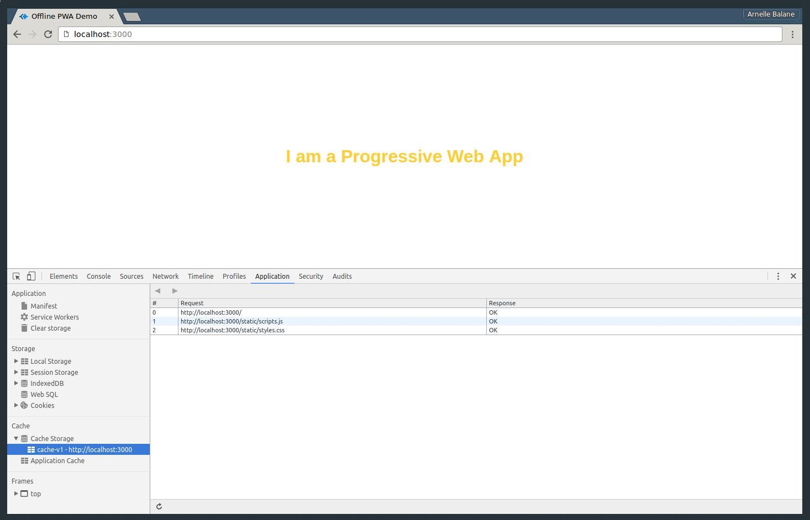
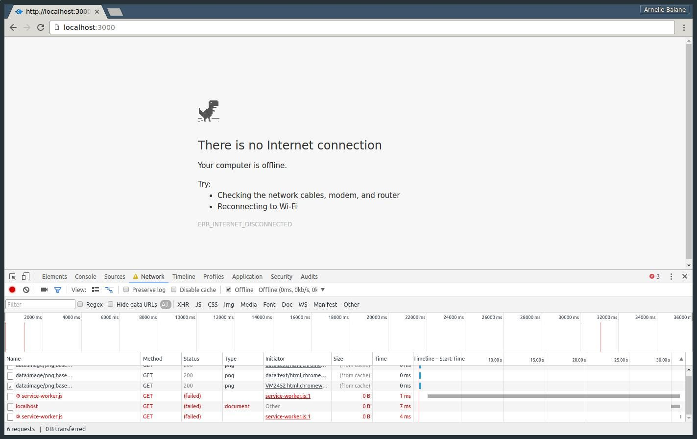
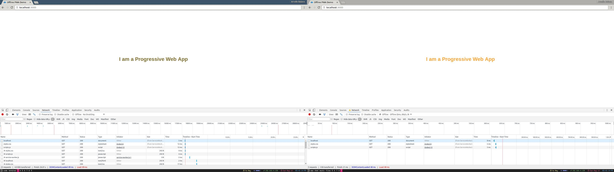

If you’ve watched (or even better, attended) the Google I/O this year, attended
any Google I/O Extended events by your local GDG chapters, or read a lot of
tech things online and follow the awesome developers on Twitter, you must have
already heard about **Progressive Web Apps**. These apps take advantage of
modern web technologies and capabilities to deliver an experience similar to
native applications. Features such as push notifications, background sync,
ability to work offline, and other things that are normally available only to
native applications can now be added to your web applications too!

To enable these features on your web applications and make them _progressive_,
all you need is one thing: a **Service Worker**. In a nutshell, a service
worker is just a script that is run by your browser in the background. That’s
right, _in the background_. Even though the browser tab running your
application is closed, the service worker will keep running the background,
listening for events and doing the job that it is programmed to do. Service
workers are the incredible technology behind progressive web apps, powering the
different functionalities that I mentioned previously.

In this tutorial, I will only show you how to make use of service workers to
give web applications basic offline capabilities. I promise I will write about
the other features and techniques in future posts. So let’s get started!

## The Demo Application

As a demo application for this tutorial, I created a very simple Express app
which only contains a single route, `/`, a single CSS file and a single
Javascript file. Your apps are most likely more complex than this, but for demo
purposes I’ll just keep it this simple. If you would like to follow along with
the tutorial, the code for this demo app is available in
[this Github repository](https://github.com/arnellebalane/offline-pwa-demo).
Checkout the `demo` branch for the version that does not have offline
capabilities yet.



<small style="display: block; text-align: center;">
    demo application when online (left) and offline (right)
</small>

As you can see, the demo app behaves just like any other “non-progressive” apps
when the network is down: it shows the “There is no internet connection” page
with the dinosaur at the top. We can’t actually do anything in this page
(except play the dino game, which is fun btw). Although there is really nothing
wrong with this page, it breaks the experience of the user browsing our app.
Let’s try to fix this by making our app available even when the user is
offline.

## The Service Worker

The first thing that we need to do is to create a service worker and register
it. Registering a service worker is telling the browser to download our service
worker script and run it in the background, and can be done by adding the
following code inside `scripts.js` (or anywhere else, as long as this gets
executed when the page loads):

```js
// scripts.js
if ('serviceWorker' in navigator) {
    navigator.serviceWorker
        .register('/service-worker.js')
        .then(function (registration) {
            console.log('Service worker registered!');
        })
        .catch(function (error) {
            console.log('Service worker registration failed!');
        });
}
```

We are wrapping the call to the `.register()` method inside an if-statement
that checks for service worker support so that it does not break when the app
is viewed on a browser that does not support service workers. As you can also
observe from the code snippet, the service worker APIs make use of Javascript
promises. If you don’t know how to use promises yet, I suggest you get familiar
with it first. Here’s a [great introductory article about Javascript promises](https://web.dev/articles/promises).
Basically they’re just objects that represent a value which will be available
sometime in the future.

Now where did that `service-worker.js` file come from? Well, we are still going
to create it. I am going to place this file inside the static directory,
together with all my other static files.

<div class="image-centered">



</div>

### Service worker scope

Service workers have this concept of “scopes” which is a set of paths that the
service worker can control. A page being “controlled” by a service worker means
that the service worker is enabling its capabilities on that page.

The scope of the service worker is determined based on the path to the service
worker file. In our case, we registered our service worker at
`/service-worker.js`, which makes its scope the root path of our app (`/`)
thus allowing it to control every path in our project. If instead we used
`/static/service-worker.js`, its scope will then be `/static`, allowing it to
only control pages whose paths start with `/static`.

Since we placed our service worker inside the static directory, it can only be
accessed through the `/static/service-worker.js` path, making its scope just
`/static`. You might come across this problem is you are using frameworks that
tell you where to place your static files, or you personally just want to place
all your static files in one organized directory and not want to make an
exception placing the service worker file in the root of the project. To work
around this, we are going to setup a new route `/service-worker.js` which will
then serve the service worker file located inside the static directory.

```js
// server.js
app.use('/static', express.static(__dirname + '/static'));
app.use('/service-worker.js', express.static(__dirname + '/static/service-worker.js'));
```

### Running the demo application

Now that we’ve created our service worker file, made it accessible from the
root path of our project, and registered it, let’s try to view our demo app and
see the changes we made so far works. Let’s run our app…

<div class="image-centered">



</div>

… and then open http://localhost:3000 in our browser.



<small style="display: block; text-align: center;">
    ヾ(⌐■_■)ノ♪
</small>

As you can see from the DevTools console, our service worker was registered
successfully and is now running in the background. Yaaay! Let’s check our app
offline…



<small style="display: block; text-align: center;">
    ಠ╭╮ಠ
</small>

Whaaat?! I thought the service worker will bring all those cool features to our
app and make it work offline! Well, we only registered an empty service worker
file, so it still does not do anything. Now let’s proceed to the real awesome
stuff: bringing things offline!

## The Cache

To make our app work offline, we make use of a cache to store the different
server responses for certain requests. Think of it as a key-value pair mapping
between request and response objects. But this cache is not just the ordinary
browser cache wherein the browser can add or remove items at its own will, but
a special cache which we programmers can manipulate as we need. Items in this
cache will always remain in there until we tell the cache to remove them. If
you want to read more about it, head over to its
[MDN documentation](https://developer.mozilla.org/en-US/docs/Web/API/Cache).

### Adding items to the cache

Caching network request-response pairs is actually really easy. First thing
that we need to do is so decide what to name the cache that we will use, then
identify the different paths that we want to cache.

```js
// service-worker.js
var cacheName = 'cache-v1';
var pathsToCache = ['/', '/static/styles.css', '/static/scripts.js'];
```

In there, I want to cache the root path `/` (which contains the HTML code for
the home page) and my CSS and Javascript files (which are requested inside the
HTML code for the home page). You can add there all the other paths and
resources that you want to place in the cache to make them available offline.

After that, we listen for the service worker’s `install` event, which is fired
once the service as been downloaded by the browser.

```js
// service-worker.js
self.addEventListener('install', function (e) {
    // do awesome stuff here, like adding items to the cache!
});
```

In case you are wondering, the `self` keyword refers to the service worker
containing this code. Anyway, it is inside the callback function for this event
listener that we actually add the items we want to cache into the cache. Let’s
do this step by step, first we need to open the cache that we want to use (it
will get created if it does not exist yet):

```js
// service-worker.js
self.addEventListener('install', function (e) {
    e.waitUntil(
        caches.open(cacheName).then(function (cache) {
            // cache is now opened, and it is the "cache" variable
        }),
    );
});
```

One thing to notice in that code is the `e.waitUntil()` method call. Since
service workers uses promises in its APIs, the `e.waitUntil()` method is the
way of saying “this callback function is done only when the given promise is
fulfilled.” You will see this a lot when you are working with service workers.
And yes of course, `caches.open()` returns a promise.

Once we have our cache open, we can then add items to it (for real this time):

```js
// service-worker.js
self.addEventListener('install', function (e) {
    e.waitUntil(
        caches.open(cacheName).then(function (cache) {
            return cache.addAll(pathsToCache);
        }),
    );
});
```

Simple as that! The service worker will then request all the paths inside the
`pathsToCache` array and store the server responses in the cache. But we have
to be careful though, because when even single path that you want to cache
fails (e.g. 404 Page Not Found), the whole caching process will fail, and the
service worker registration will fail. But no need to worry, as the browser
will try to do it again the next time you open the app or when it gets
reloaded.

Like all other good developers, let’s chain a catch method call to our
`caches.open()` promise to handle anything that goes wrong while we are caching
things.

```js
// service-worker.js
self.addEventListener('install', function (e) {
    e.waitUntil(
        caches
            .open(cacheName)
            .then(function (cache) {
                return cache.addAll(pathsToCache);
            })
            .catch(function (error) {
                console.error('Oops, something bad happened!', error);
            }),
    );
});
```

And that’s it, we’ve already cached the necessary resources for our app to work
offline.

### Service worker lifecycle

Before we go and check our work, let me just remind you that we already
registered a service worker before (remember the empty service worker file?
yes, it’s still there running in the background). So how do we remove our
previous service worker version and replace it with an updated one?

Easy, we simply need to make some changes to our service worker file (which we
already did \ (•◡•) /). Whenever you navigate to the app, the browser will
check in the background if the service worker file in the server still has the
same contents as the one currently registered, and the tiniest difference in
their contents will make the browser think that it has been updated and cause
it to re-download it and run the whole registration and installation process
again.

But that new service worker will not take over the old one right away when the
latter is still controlling pages. Only when the old service worker does not
control any pages anymore (either those pages are closed or reloaded) that it
is removed by the browser and the new one take over control of new pages.

Okay now let’s check our demo app and see if the caching functionality that we
added works.



<small style="display: block; text-align: center;">
    (~˘▾˘)~
</small>

Yay it did! (if it seems like it didn’t, refresh your browser one more time to
make sure that it is using the new service worker) Looking at the “Cache
Storage” item in the “Application” tab in the DevTools (or in “Resources” if
you are using a version of Chrome lower than 52), we can see that our cache
“cache-v1” has been created and the resources that we wanted to cache are now
stored in there properly. Now let’s try it offline…



<small style="display: block; text-align: center;">
    ┻━┻ ︵ヽ(`Д´)ﾉ︵ ┻━┻
</small>

(ノಠ益ಠ)ノ彡┻━┻

Okay so we’ve added the necessary resources for displaying our demo app to the
cache, but we are still lacking one last piece of this whole offline web
application puzzle. We still need to tell the service worker to use the cached
resources instead of fetching them from the network.

## Intercepting Network Requests

When a browser requests for resources to render a page, it defaults to
requesting it from the network. But with our service worker, we can intercept
these network requests and respond to them with whatever we want, like for
example the cached resources that we have. To do that, we listen for the
service worker’s `fetch` event, which is fired for every resource requested by
the browser.

```js
// service-worker.js
self.addEventListener('fetch', function (e) {});
```

To see how to things work, let’s make our service worker fetch the resources
from the network for now every time it intercepts a request, just like what
would happen if it did not exist.

```js
// service-worker.js
self.addEventListener('fetch', function (e) {
    e.respondWith(fetch(e.request));
});
```

Here we are fetching the requested resource from the network using the
[Fetch API](https://developer.mozilla.org/en-US/docs/Web/API/Window/fetch),
which is a new API similar to XMLHttpRequest but more powerful, more flexible
and uses promises. The `e.respondWith()` method accepts a Promise that resolves
to a custom response which will then be sent to the browser as the response for
the resource that it requested. In this case, we are just responding with
whatever the result of fetching the resource from the network.

But what if the user is offline? The `fetch()` request will fail, as it can’t
reach our server where it will get the resources. When that happens, we can
handle the failure and just serve our cached resources instead. First, we need
to open the cache where we stored our resources:

```js
// service-worker.js
self.addEventListener('fetch', function (e) {
    e.respondWith(
        fetch(e.request).catch(function () {
            return caches.open(cacheName).then(function (cache) {});
        }),
    );
});
```

Once we have our cache, we can then respond with the cached response object
matching the current request:

```js
// service-worker.js
self.addEventListener('fetch', function (e) {
    e.respondWith(
        fetch(e.request).catch(function () {
            return caches.open(cacheName).then(function (cache) {
                return cache.match(e.request);
            });
        }),
    );
});
```

Now that we have those changes, let’s check our app again…



<small style="display: block; text-align: center;">
    demo app when online (left) and offline (right)
</small>

Now that we are serving the cached responses when the user is offline, our demo
app already works offline! Congratulations for surviving this far in the
tutorial! (ﾉ◕ヮ◕)ﾉ\*:･ﾟ✧

## Conclusion

Let’s summarize the things that we did to make our demo application work
offline:

1. Create and register a Service Worker, making sure that it’s scope it at `/`
1. In the service worker’s `install` event, we cache the different resources
   that we want to be available offline
1. We intercept network requests by listening to the service worker’s `fetch`
   event
1. We attempt to fetch the requested resource from the network
1. If the network request fails, we fallback to using the cached resources

As we can see, using a Service Worker and other modern web APIs to make our
demo application work offline was not that difficult. There are other
techniques of doing this, things like “offline first” and such, but I won’t be
talking about that here now as this post is already long enough. I definitely
will write about them in the future though, so check back here in a while to
see if it’s already published ;)

Thanks for reading and happy building!

(If you want to see the code for the finished demo application, it is available
in this repo: [https://github.com/arnellebalane/offline-pwa-demo](https://github.com/arnellebalane/offline-pwa-demo))
