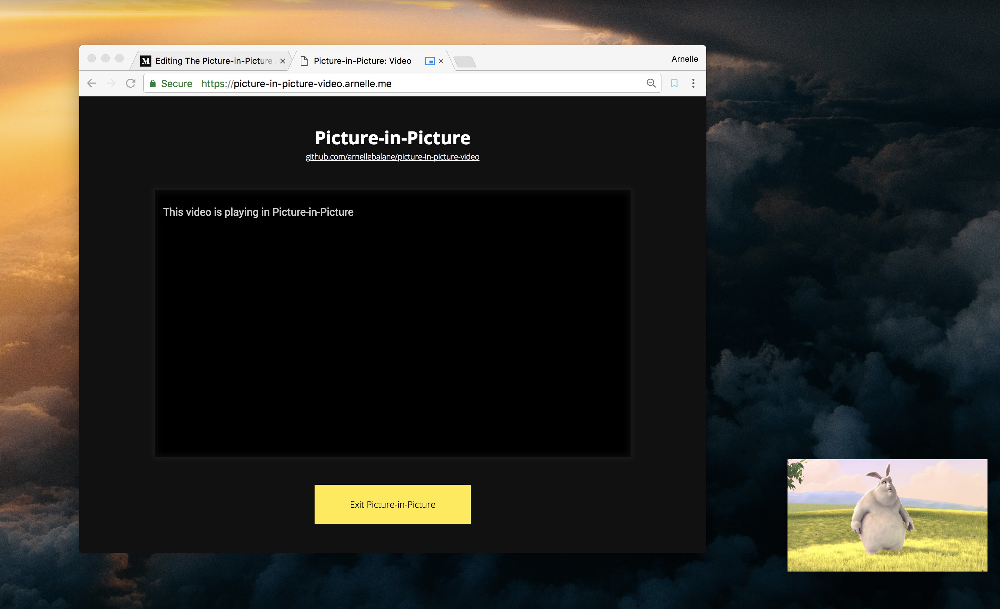
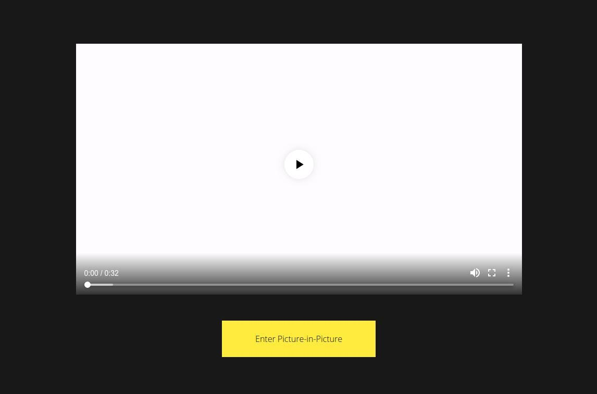
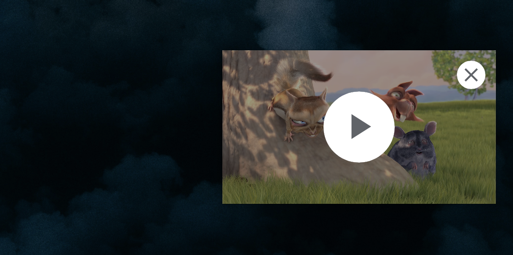

The Picture-in-Picture API (PiP) is a new experimental Web Platform API that
allows Web pages to play a video in a little window that stays on top of other
windows. This feature is valuable for video sites that want their users to
continue watching their videos while doing something else, for example watch a
coding tutorial video while also coding along in their text editors, etc.



Picture-in-Picture is currently behind browser flags (like, 3 of them) in
Chrome 69, but we should be able to play around with them now by getting the
latest Chrome version and enabling these flags.

This article will walk you through getting started with Picture-in-Picture to
make your videos stay on top of other windows too. You can also check out the
[GitHub repository](https://github.com/arnellebalane/picture-in-picture-video)
and [live demo](https://picture-in-picture-video.arnelle.dev/) straight away if
you want.

## Enable Picture-in-Picture

Before we get into the code, let's first make sure that we can view our results
on the browser properly by enabling the required Chrome browser flags. Go to
`chrome://flags` on your Chrome browser and enable the following:

- Experimental Web Platform features
- Enable Picture-in-Picture
- Enable the use of SurfaceLayer objects for videos

## Starting Point

For this article we will be using the following HTML markup as our starting
point:

```html
<video src="https://cdn.arnellebalane.com/videos/original-video.mp4" controls></video>
<button>Enter Picture-in-Picture</button>
```

On the page, this will display a video element playing the Big Buck Bunny
trailer and a button to toggle Picture-in-Picture; and with some styling,
will look like this:



In our JavaScript code, we're also going to define variables to reference both
the video and button elements.

```js
const video = document.querySelector('video');
const button = document.querySelector('button');
```

## Check support for Picture-in-Picture

Not all users who visit your page will be using a browser that supports
Picture-in-Picture, so we only enable it if it is supported by the browser.
This is called **progressive enhancement**, and it is important to do this so
that users won't have a broken experience if their browsers don't support
Picture-in-Picture.

Checking for Picture-in-Picture support can be done by checking for the
`pictureInPictureEnabled` property on the `document` object:

```js
if (!document.pictureInPictureEnabled) {
    // Let the user know that PiP is not enabled/supported.
    button.textContent = 'PiP is not supported in your browser.';
    button.disabled = true;
}
```

The specification says that `document.pictureInPictureEnabled` _"is true if
there is no previously-established user preference, restrictions, or platform
limitation, and `false` otherwise."_ I don't know what all of these preferences,
restrictions, and limitations are, but it is `false` when any of the required
browser flags are not enabled. For older browsers, this properly will just be
`undefined` which is a false-y value.

## Requesting Picture-in-Picture

Once we've determined that the browser supports Picture-in-Picture, we can now
safely use the API. In our example, we will make the video go into
Picture-in-Picture mode when the "Enter Picture-in-Picture" button is clicked.

We can make a video go into Picture-in-Picture mode by calling the
`requestPictureInPicture()` method on it, which returns a
[Promise](https://developer.mozilla.org/en-US/docs/Web/JavaScript/Guide/Using_promises)
object which can be used to determine if the request succeeded or not.

```js
button.addEventListener('click', () => {
    video
        .requestPictureInPicture()
        .then(() => {
            /**/
        })
        .catch(() => {
            /**/
        });
});
```

When the Promise resolves, the video will go into Picture-in-Picture mode and
the `document.pictureInPictureElement` property will be set to the element that
is currently in Picture-in-Picture mode, i.e. our `video` element.



## Leaving Picture-in-Picture

Users can get out of Picture-in-Picture mode by clicking on the "x" icon on the
Picture-in-Picture window.

However, we can also add a way in our page for the user to exit from
Picture-in-Picture. In our example, clicking on the "Enter Picture-in-Picture"
button while there is a Picture-in-Picture window should close it.

We modify our button's click event handler to check if there is already a video
element displayed in Picture-in-Picture mode. If there is, we close it by
calling the `document.exitPictureInPicture()` method.

```js
button.addEventListener('click', () => {
    if (document.pictureInPictureElement) {
        document
            .exitPictureInPicture()
            .then(() => {
                /**/
            })
            .catch(() => {
                /**/
            });
    } else {
        // Request Picture-in-Picture
    }
});
```

Leaving Picture-in-Picture sets the `document.pictureInPictureElement` property
back to `null`.

## Picture-in-Picture Events

As elements enter and exit from Picture-in-Picture, they fire events to report
these changes. Picture-in-Picture defines two new events on video elements:
`enterpictureinpicture` and `leavepictureinpicture` , which get fired when the
element enters and leaves Picture-in-Picture respectively.

Let's use these events in our example to update our button's label depending on
whether the video is in Picture-in-Picture or not.

```js
video.addEventListener('enterpictureinpicture', () => {
    button.textContent = 'Exit Picture-in-Picture';
});

video.addEventListener('leavepictureinpicture', () => {
    button.textContent = 'Enter Picture-in-Picture';
});
```


## Conclusion

And that's it about the Picture-in-Picture API! Here are some final notes and
thoughts about it:

1. It currently only works on video elements at the moment, but is meant to be
   extensible. This means that we could potentially have the ability to place
   any other elements in the Picture-in-Picture window in the future.
1. The number of allowed Picture-in-Picture windows is left to the browser's
   implementation and the platform.
1. The Picture-in-Picture window stays on the bottom-right corner of the
   screen. It would be nice to have the ability to drag it around and resize it.

## Resources

- [Picture-in-Picture Editor's Draft](https://w3c.github.io/picture-in-picture/)
- [Picture-in-Picture (PiP) post](https://developer.chrome.com/blog/picture-in-picture) by François Beaufort
