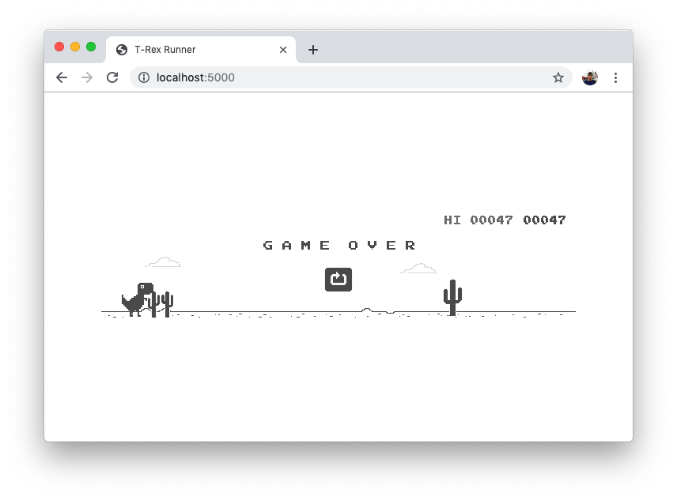
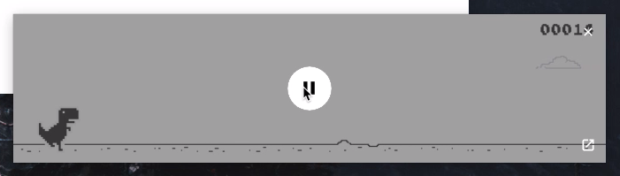

The Picture-in-Picture API is a new Web platform API that allows websites to
play videos in a little floating window that stays on top of other windows even
when the browser is not visible, allowing us to continue watching these videos
while we interact with other websites or applications.

The API is currently limited to video elements only. Fortunately, we can also
create video streams from canvas elements. This means that we can draw anything
on a canvas and have it appear on a Picture-in-Picture window. Experimenting
with this eventually led me into trying to make Chrome's offline T-Rex runner
game playable inside a Picture-in-Picture window ([click here][11] to play it
now).

<div class="h-[721px]">
    <blockquote class="twitter-tweet">
        <p lang="en" dir="ltr">Another Picture-in-Picture experiment: running Chrome&#39;s T-Rex runner game inside a Picture-in-Picture window 🦖<br><br>(Use play/pause media buttons on keyboard, headphones, etc. to jump! 🔥)<a href="https://twitter.com/hashtag/webdev?src=hash&amp;ref_src=twsrc%5Etfw">#webdev</a> <a href="https://twitter.com/hashtag/javascript?src=hash&amp;ref_src=twsrc%5Etfw">#javascript</a> <a href="https://twitter.com/hashtag/webapis?src=hash&amp;ref_src=twsrc%5Etfw">#webapis</a><a href="https://t.co/7m1q58CCWT">https://t.co/7m1q58CCWT</a><a href="https://t.co/TXQGQj26BH">https://t.co/TXQGQj26BH</a> <a href="https://t.co/3djT9qW6UR">pic.twitter.com/3djT9qW6UR</a></p>&mdash; Arnelle Balane (@arnellebalane) <a href="https://twitter.com/arnellebalane/status/1134838128127012864?ref_src=twsrc%5Etfw">June 1, 2019</a>
    </blockquote>
    <script async src="https://platform.twitter.com/widgets.js" charset="utf-8"></script>
</div>

## Get the game's source code

We can get the game's source code from the [Chromium repository][1]. We copy
the contents in that location, rename some of the files, and clean up the HTML
to only contain this necessary markup inside the `<body>`:

```html
<!-- This will contain the canvas element -->
<div class="interstitial-wrapper"></div>

<!-- Game assets: sprits + audio -->
<div id="offline-resources">
    
    

    <div id="audio-resources">
        <audio id="offline-sound-press" src="sounds/button-press.mp3"></audio>
        <audio id="offline-sound-hit" src="sounds/hit.mp3"></audio>
        <audio id="offline-sound-reached" src="sounds/score-reached.mp3"></audio>
    </div>
</div>

<!-- The main game script -->
<script src="offline.js"></script>

<!-- Initialize the canvas and the game. -->
<!-- Originally performed inside neterror.js -->
<script>
    const runner = new Runner('.interstitial-wrapper');
</script>
```

This gives us an exact replica of the offline T-Rex runner game which we can
already play with:



## Implement programmatic T-Rex jump

The T-Rex jumps every time we press on the spacebar. Let's add a way to
programatically make our T-Rex jump without us having to actually press the
spacebar.

Digging through the game's code, we will find two methods on the `runner`
object that handles the spacebar key:

1. [`onKeyDown`][2], makes the T-Rex jump while the game is running.
2. [`onKeyUp`][3], restarts the game when the T-Rex crashed into an obstacle.

Let's write a method that calls either of these based on the state of the game,
passing in a _dummy_ keyboard event.

```js
function simulateSpacebar() {
    const keyboardEventOptions = {
        code: 'Space',
        keyCode: 32,
    };

    if (runner.crashed) {
        const event = new KeyboardEvent('keyup', keyboardEventOptions);
        runner.onKeyUp(event);
    } else {
        const event = new KeyboardEvent('keydown', keyboardEventOptions);
        runner.onKeyDown(event);
    }
}
```

## Capture video stream of canvas contents

Calling `new Runner('...')` creates a canvas element and inserts it into the
page. We need to get a reference to that canvas element, and then capture its
contents as a video stream:

```js
const canvas = document.querySelector('canvas');
const videoStream = canvas.captureStream();
```

We then create a `video` element with the video stream as the source:

```js
const video = new Video();
video.srcObject = videoStream;

video.muted = true;
video.play();
```

Here we're also muting the video so we can autoplay it
(see [Chrome's autoplay policy][5]).

## Show the Picture-in-Picture window

When using new Web APIs like Picture-in-Picture, always feature-detect if they
are available before trying to use them. This makes sure that our apps don't
break when the API is not available, and only progressively enhance the
experience when it is available. For Picture-in-Picture, it can be done by
checking the `document.pictureInPictureEnabled` property:

```js
const button = document.querySelector('button');

if (document.pictureInPictureEnabled) {
    // Picture-in-Picture is available!
    // Subsequent code snippets will be place inside this block.
} else {
    // Picture-in-Picture is not available. User can still play the game normally in the page.

    button.textContent = 'Picture-in-Picture is not available';
    button.disabled = true;
}
```

We also add a `<button>` element to the page, which the user can click to
enter Picture-in-Picture. We want to give this control to our users, usually
through a Picture-in-Picture icon in the UI, so that they can decide when they
want to view our content in the Picture-in-Picture window.

Now to the fun part, let's show our video stream in the Picture-in-Picture
window when the button is clicked!

```js
button.addEventListener('click', async () => {
    simulateSpacebar();
    await video.requestPictureInPicture();
});
```

The result looks like this:

<div class="video-embed">
    <iframe
        width="560"
        height="315"
        src="https://www.youtube.com/embed/JxmrlG_ROAY?si=4AvVVgaUT_SR4e5d"
        title="YouTube video player"
        frameborder="0"
        allow="accelerometer; autoplay; clipboard-write; encrypted-media; gyroscope; picture-in-picture; web-share"
        referrerpolicy="strict-origin-when-cross-origin"
        allowfullscreen
    ></iframe>
</div>

## Implement game controls

The Picture-in-Picture window can stay on top of other application windows, and
in that case we won't be able to press the spacebar key on the page to make the
T-Rex jump, so we need another way to make it do that.

### Media Session API to the rescue!

The [Media Session API][4] allows websites to customize media notifications, as
well as define event handlers for playback controls (e.g. play, pause, etc.).
We can make our T-Rex jump whenever we press the play/pause buttons on our
keyboards (or other devices that can control media playback) by defining `play`
and `pause` event handlers.

```js
navigator.mediaSession.setActionHandler('play', simulateSpacebar);
navigator.mediaSession.setActionHandler('pause', simulateSpacebar);
```

The Picture-in-Picture API integrates well with the Media Session API. When we
define the playback event handlers, the Picture-in-Picture window will also
display their corresponding action buttons.



## Let's play!

With all of those changes in place, we've now made the T-Rex Runner game
playable inside a Picture-in-Picture window, using our play/pause media buttons
to make the T-Rex jump!

You can find the live demo of this project, as well as the complete source code,
in the following links:

- https://pip-trex.arnelle.dev/
- https://github.com/arnellebalane/pip-trex

## Conclusion

In this article we were able to use the Picture-in-Picture API and Media
Session API to build something silly. There are more serious and useful uses
for these APIs- Youtube has [a hidden Picture-in-Picture button][6] in their
player controls, and before I worked on this experiment, I also built a demo on
[displaying audio visualization inside a Picture-in-Picture window][7] using
the same techniques in this article.

If you've built / are currently working on something that uses these APIs, or
see some really amazing uses of them in the wild, please share them with us in
the comments, I'd love to hear about them!

## Resources

- [The Picture-in-Picture API][8]
- [Watch video using Picture-in-Picture][9] by François Beaufort
- [Customize Media Notifications and Handle Playlists][10] (Media Session API)
  by François Beaufort

[1]: https://chromium.googlesource.com/chromium/src/+/master/components/neterror/resources/
[2]: https://chromium.googlesource.com/chromium/src/+/master/components/neterror/resources/offline.js#676
[3]: https://chromium.googlesource.com/chromium/src/+/master/components/neterror/resources/offline.js#727
[4]: https://developer.mozilla.org/en-US/docs/Web/API/Media_Session_API
[5]: https://developers.google.com/web/updates/2017/09/autoplay-policy-changes
[6]: https://twitter.com/arnellebalane/status/1118537633548759041
[7]: https://twitter.com/arnellebalane/status/1134768178318303232
[8]: https://blog.arnellebalane.com/the-picture-in-picture-api-30415372009f
[9]: https://developers.google.com/web/updates/2018/10/watch-video-using-picture-in-picture
[10]: https://developers.google.com/web/updates/2017/02/media-session
[11]: https://pip-trex.arnelle.dev/
