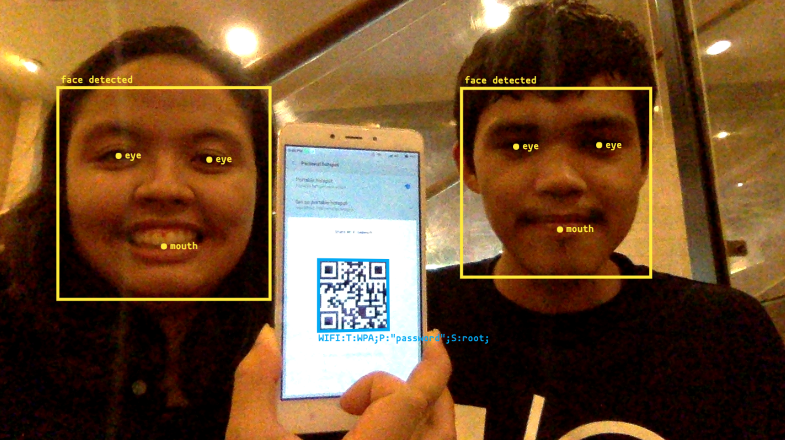
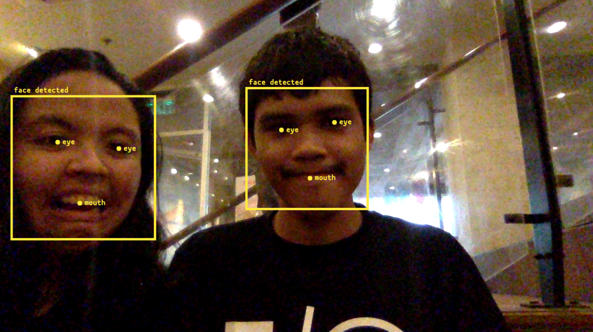
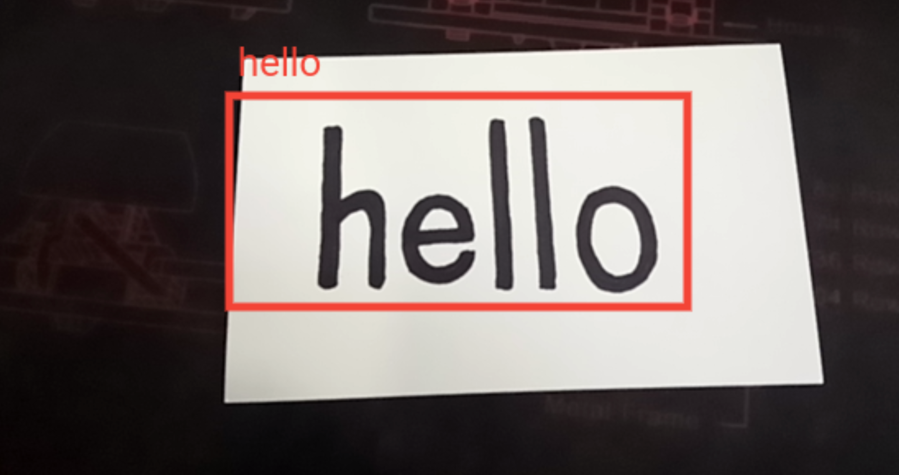
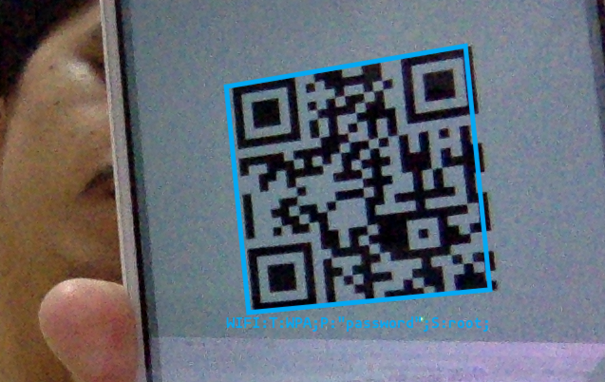

Photos constitute a large chunk of the information in the Internet, especially
in this modern age. Some of these images consist of recognizable features such
as human faces, text, barcodes, and QR codes. These features have a lot of use
cases, but detecting them is very computationally expensive. Fortunately,
hardware manufacturers, particularly on mobile devices, have already started
supporting these features on their platforms. These have been powering several
applications such as face detection in cameras, barcode scanner apps, and many
others. Web applications, on the other hand, still don't have access to these
hardware capabilities, making it necessary to use computationally demanding
libraries and third-party services. The Shape Detection API aims to change
this.

The Shape Detection API is an experimental API for detecting "shapes" (i.e.
faces, barcodes, and text) in images on the Web using the integrated hardware
capabilities. The API is currently being incubated by the Web Platform Incubator
Community Group (WICG), hopefully it gets standardized soon as it's going to be
a good addition to the Web's capabilities.

Anyway, the current Editor's Draft of the Shape Detection API provides three
interfaces: **FaceDetector**, **TextDetector**, and **BarcodeDetector**. These
APIs are already available behind a flag since Chrome 57 and Opera 44, both for
desktop and mobile. In Chrome, you can enable them by enabling the Experimental
Web Platform Features flag. Each of these APIs detect features from an image
source, so let's talk about that briefly.

**Update: Sept. 20, 2018**

As of Chrome 70 (beta as of Sept. 13, 2018), the Shape Detection API is already
available for Origin Trial. This means that visitors to your site can
experience features that use the Shape Detection API without having to enable
the experimental features flag.

In order to do that, you would need to sign up for Chrome's origin trials
through [this form](https://docs.google.com/forms/d/1OTvEk-VfavyKkMxef0Tvs0RFycl9NNu1vdg3FrqJhX8/closedform).
They will then email you with your origin trial token and instructions on how
to use it.

## Image Sources

An image source is the image that is going to be used for the detection
process, and can be one of the following:

1. An `HTMLImageElement`, or ``. In this case, shapes will be detected
   from the image represented by the element. If the element represents an
   animated image (e.g. a gif), the animation's default image will be used if
   one is available. Otherwise, the first frame of the animation will be used.
1. An `HTMLVideoElement`, or `<video>`. In this case, the video frame at the
   current playback position when shape detection was invoked will be used as
   the image source.
1. An `HTMLCanvasElement`, or `<canvas>`. In this case, whatever's currently
   rendered on the element will be used as the image source.

## Face Detection

Face detection can be done using the `FaceDetector` interface. `FaceDetector`
represents the underlying platform's component for detecting human faces in
images. To start using it, all you have to do is create a `FaceDetector`
instance in your Javascript code.

```js
const faceDetector = new FaceDetector({
    maxDetectedFaces: 10,
    fastMode: true,
});
```

The `FaceDetector` constructor accepts an optional options object with the
following properties:

- `maxDetectedFaces`: The maximum number of faces to look for in the image
  source.
- `fastMode`: Tells the browser to try to prioritize speed over accuracy.

The `FaceDetector` instance's `detect()` method can then be used to detect
human faces from the given image source.

```js
const imageSource = document.querySelector('img');
// Or you can use a video or canvas element as an image source

faceDetector.detect(imageSource).then(handleDetectedFaces).catch(console.error);
```

`faceDetector.detect()` returns a Javascript Promise which resolves to an array
of `DetectedFace` objects for each human face that was detected from the image
source. Each `DetectedFace` object has the following properties:

- `boundingBox`: An object describing a rectangle that indicates the position
  and boundaries within the image where the face was detected.
- `landmarks`: An array of `Landmark` objects. A landmark is a feature of
  interest that are related to the detected face, which at the moment can only
  either be the mouth or an eye. In some cases when the platform cannot
  provide landmarks information, this property will just be `null`.

```js
function handleDetectedFaces(detectedFaces) {
    // detectedFaces could look like this:
    // [
    //     {
    //         boundingBox: {
    //             x: 545,
    //             y: 187,
    //             top: 187,
    //             left: 545,
    //             right: 855,
    //             bottom: 497,
    //             width: 310,
    //             height: 310
    //         },
    //         landmarks: [
    //             {
    //                 locations: { x: 627.5, y: 262.5 },
    //                 type: 'eye'
    //             },
    //             {
    //                 locations: { x: 763, y: 258 },
    //                 type: 'eye'
    //             },
    //             {
    //                 locations: { x: 701, y: 418 },
    //                 type: 'mouth',
    //             }
    //         }
    //     }
    // ]
}
```

These objects can be used for many things, like adding a rectangle overlay
around each detected face:



<small style="display: block; text-align: center;">
    FaceDetector API
</small>

## Text Detection

Text detection can be done using the `TextDetector` interface. `TextDetector`
represents the underlying platform's component for detecting texts in images.
To start using it, all you have to do is create a `TextDetector` instance in
your Javascript code.

```js
const textDetector = new TextDetector();
```

The `TextDetector` constructor does not accept any arguments, and the instance
has a `detect()` method which can be used to detect texts from the given image
source.

```js
const imageSource = document.querySelector('img');
// Or you can use a video or canvas element as an image source

textDetector.detect(imageSource).then(handleDetectedTexts).catch(console.error);
```

`textDetector.detect()` returns a Javascript Promise which resolves to an array
of `DetectedText` objects for each text that was detected from the image
source. Each `DetectedText` object has the following properties:

- `boundingBox`: An object describing a rectangle that indicates the position
  and boundaries within the image where the text was detected.
- `rawValue`: The string value of the detected text.

```js
function handleDetectedTexts(detectedTexts) {
    // detectedTexts could look like this:
    // [
    //     {
    //          boundingBox: {
    //              x: 469,
    //              y: 466,
    //              top: 466,
    //              left: 469,
    //              right: 585,
    //              bottom: 485,
    //              width: 116,
    //              height: 19
    //          },
    //          rawValue: 'hello'
    //     }
    // ]
}
```



<small style="display: block; text-align: center;">
    TextDetector API
</small>

## Barcode Detection

Barcode detection can be done using the `BarcodeDetector` interface.
`BarcodeDetector` represents the underlying platform's component for detecting
barcodes and QR codes in images. Aside from detection, it also decodes the
message represented by the barcode or QR code. To start using it, all you have
to do is create a `BarcodeDetector` instance in your Javascript code.

```js
const barcodeDetector = new BarcodeDetector();
```

The `BarcodeDetector` constructor does not accept any arguments, and the
instance has a `detect()` method which can be used to detect barcodes from the
given image source.

```js
const imageSource = document.querySelector('img');
// Or you can use a video or canvas element as an image source

barcodeDetector.detect(imageSource).then(handleDetectedBarcodes).catch(console.error);
```

`barcodeDetector.detect()` returns a Javascript Promise which resolves to an
array of `DetectedBarcode` objects for each barcode that was detected from the
image source. Each `DetectedBarcode` object has the following properties:

- `boundingBox`: An object describing a rectangle that indicates the position
  and boundaries within the image where the barcode was detected.
- `rawValue`: The string value that was decoded from the barcode.
- `cornerPoints`: An array of points corresponding to the coordinates of each
  corner of the detected barcode. It starts with the top-left corner and goes
  in clockwise direction. The points do not necessarily represent a proper
  rectangle or square due to perspective distortions.

```js
function handleDetectedBarcodes(detectedBarcodes) {
    // detectedBarcodes could look like this:
    // [
    //     {
    //          boundingBox: {
    //              x: 320,
    //              y: 366,
    //              top: 366,
    //              left: 320,
    //              right: 524,
    //              bottom: 563,
    //              width: 204,
    //              height: 197
    //          },
    //          rawValue: 'https://arnellebalane.com/',
    //          cornerPoints: [
    //              { x: 391, y: 366 },
    //              { x: 524, y: 428 },
    //              { x: 462, y: 563 },
    //              { x: 320, y: 506 }
    //          ]
    //     }
    // ]
}
```



<small style="display: block; text-align: center;">
    BarcodeDetector API
</small>

## Additional Notes

Using the Shape Detection API is not as hard as you might initially think, but
here are some caveats that you will need to look out for (although I believe
that this is because the API is still in its very early stages):

1. The availability of the the `FaceDetector`, `TextDetector`, and
   `BarcodeDetector` constructors only means that the Shape Detection API is
   available in the browser, but not necessarily that the underlying platform
   has support for those features. If the platform does not support a
   particular feature, `.detect()` will reject with an error saying e.g.
   _"Face detection service unavailable."_
1. In Chrome Canary v61 for macOS, `TextDetector` can detect text and its
   bounding box properly, but the rawValue is just an empty string.
1. In multiword texts, `TextDetector` sometimes detects the entire string, and
   sometimes by word or groups of words.
1. All detectors are currently not available in desktop Chrome for Ubuntu.

## Conclusion

I made [a little demo](https://shape-detection-api.arnelle.dev/) showcasing the
APIs that I talked about in the previous sections. The demo gets a video stream
from your webcam and tries to detect shapes from the stream. To view it, you
need to be using Chrome 57 or newer and enable the Experimental Web Platform
Features flag.

The Shape Detection API gives Web applications the privilege to use the
underlying platform's capabilities for detecting faces, texts, and barcodes in
images. Since it is a native Web API already available directly within the
browsers, this could potentially eliminate the need for third-party libraries
and services depending on the use case. This could also result in faster Web
applications which would be really great for our users. And since it can work
offline, it would be useful for Progressive Web Apps that require shape
detection capabilities.

## Resources

- [Accelerated Shape Detection in Images](https://wicg.github.io/shape-detection-api/):
  The latest Editor's Draft for the Shape Detection API.
- [Shape Detection API Specification](https://github.com/WICG/shape-detection-api):
  The WICG Github repository for the Shape Detection API specification.
- [arnellebalane/shape-detection-demo](https://github.com/arnellebalane/shape-detection-demo):
  The Github repository for my Shape Detection API demo application.
