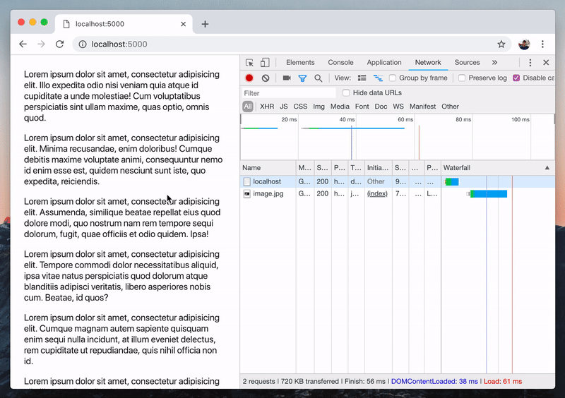
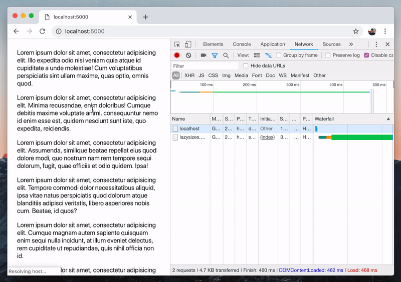
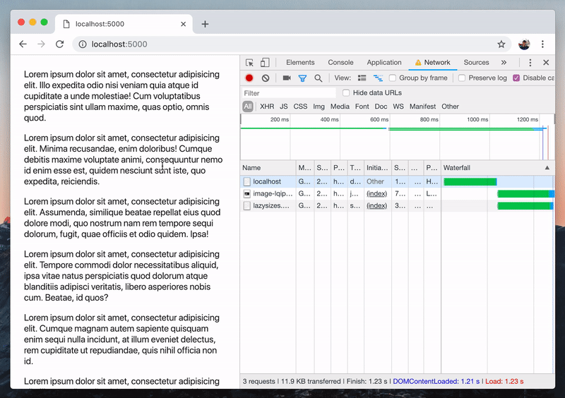

Images constitute a large portion of the page weights of a lot of Web pages.
They make our pages more enjoyable to look at, but can also hurt our page load
times especially when they have large file sizes or when there are a lot of
them on the page, not to mention that they can unnecessarily consume our users'
bandwidths. One way to deal with these concerns is to **lazyload** our images.


Lazyloading means that we load our images only when they are going to be visible
in the page. For example, an image located somewhere near the end of a long
article doesn't need to be loaded until the user actually scrolls it into view.

We can implement our own lazyloading functionality with JavaScript using some
modern Web APIs (such as the [Intersection Observer API](https://medium.com/arnelle-balane/the-intersection-observer-api-d441be0b088d)),
or use an image lazyloading library like [**lazysizes**](https://github.com/aFarkas/lazysizes)
by [aFarkas](https://github.com/aFarkas). What I like about this library is
that it is very easy to start using it, and is performant while being packed
with tons of amazing features.

## Example Web page

Let's create an example Web page with an image which we want to lazyload later
on with lazysizes. Our example page is going to have the following markup:

```html
<p>Lorem ipsum dolor sit amet...</p>
<!-- 9 more lorem ipsum paragraphs -->


<!-- 3 more lorem ipsum paragraphs -->
```



<small style="display: block; text-align: center">Example Web page with an image</small>

Notice from DevTools' Network tab that the image has already been loaded since
the page has loaded. Let's try to change that to only load it when it is about
to scroll into view using lazysizes.

## Basic usage

To start using lazysizes, the first thing we need to do is load the lazysizes
JavaScript file:

```js
<script src="http://afarkas.github.io/lazysizes/lazysizes.min.js"></script>
```

It can also be installed via npm (`npm install lazysizes`) or bower
(`bower install lazysizes`).

Second, we modify the `img` tags that we want to lazyload to:

1. Use `data-src` attribute instead of `src`, and
1. Add `lazyload` as one of its classes

```html
<!-- Before: -->


<!-- After: -->

```

And the result?



<small style="display: block; text-align: center">Basic lazysizes usage result</small>

Notice from DevTools' Network tab how the image is only loaded once it's about
to be scrolled into view. Awesome!

## Lazyload responsive images

We can serve responsive images on the Web using the `srcset` attribute on the
`img` element or using the `picture` element. This allows us to serve an
appropriately-sized image to our users depending on their screen sizes.

One really cool feature of lazysizes that I really like is its ability to
lazyload these responsive images without any additional configuration. All we
have to do is to replace the `srcset` attribute with `data-srcset`.

```html
<!-- Before: -->


<!-- After: -->

```

## Use a low-quality image placeholder

One potential concern with our lazyloaded images at this point is that when the
user's network connection is slow, it will still take a long time for the
images to show up, leaving us with a blank space in our page.

We can address this by displaying a small-sized, low-quality image as a
placeholder until the actual image finishes loading. Because of its very small
size, this placeholder image will load very quickly, giving the user an idea of
what the actual image is going to look like. To do that, we add the placeholder
image as the `src` attribute of the `img` tag.

```html

    width="300"
    height="200"
    alt="Responsive Image"
>
```

Adding the `width` and `height` attributes makes the small-sized image take up
the space of the actual image. This can also be done via CSS.



<small style="display: block; text-align: center">Lazysizes, using a low-quality image placeholder</small>

## Summary

So far we've looked at how to use lazysizes to lazyload images for basic use
cases. With the changes we've made, users will get to download the images in
our page only when necessary. As a result, our page loads faster since it
doesn't need to wait for the large image to finish loading. We also keep the
users from unnecessarily consuming their bandwidths on images that they're not
going to see yet.

However, we've only scratched the surface of what lazysizes offers. It offers
much more features and different configurations and other patterns of how it
can be used for more advanced use cases, so definitely check out the library's
[documentation](https://github.com/aFarkas/lazysizes) for those, and let's all
make our Web experiences better together by lazyloading our images.
