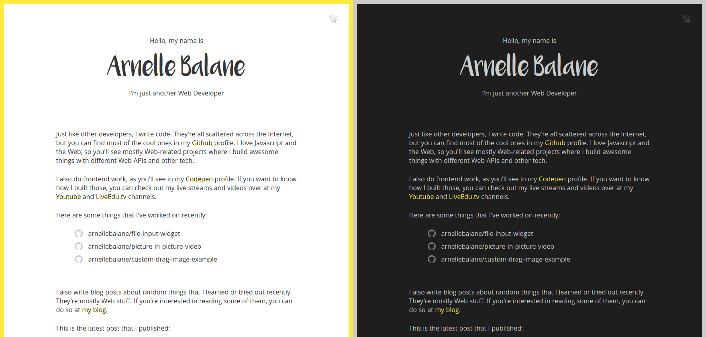
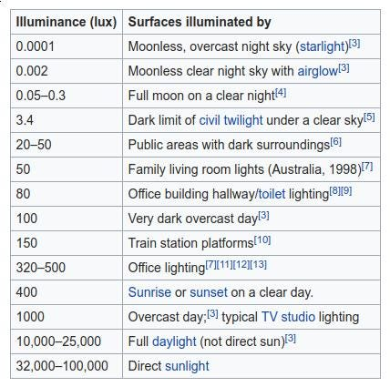

I just added a new enhancement to my website: **dark mode**! Because, you know,
you might be viewing it at night and I don't want you to get blinded by the
brightness of the screen ;)



This article will quickly walk through how I implemented dark mode, and how I
made it even cooler by automatically toggling on/off depending on the
brightness of the environment.

## CSS Custom Properties

I am using CSS Custom Properties (also referred to as CSS variables) to define
the colors that I am using throughout my site. This allows me to place all
color definitions in one place, and easily reuse them in other places in my
stylesheet.

```css
html {
    --primary-color: #ffeb3b;
    --border-color: var(--primary-color);
    --text-color: #333;
    --background-color: #fff;
}
```

To add dark mode styles, all I have to do is change the values of these custom
properties, and the changes will be applied in all the other places that are
using them. In my case, I add the dark mode styles when the `<html>` element has
the class `dark`.

```css
html.dark {
    --border-color: #ccc;
    --text-color: #ccc;
    --background-color: #181818;
}
```

There are also other minor adjustments needed, like making some links stand out
in dark mode by making them use `--primary-color` instead of the default
`--text-color`.

## Toggling Dark Mode

With the styles in place, I then enable it by adding the `dark` class to the
`<html>` element. But I want that class to be added dynamically, so I add a
button on the page which can be clicked to manually toggle dark mode.

```js
<button class="toggle-theme"></button>;

// JS
const html = document.querySelector('html');
const button = document.querySelector('button');
button.addEventListener('click', () => {
    html.classList.toggle('dark');
});
```

## Using Ambient Light Sensor

Now time for the cool part! I then make the dark mode theme automatically
enable itself when the surroundings is dark, and then disable when it gets
bright. To achieve that, I used the Ambient Light Sensor API.

A lot of devices already have light sensors built-in on them, and the good news
is that readings from these sensors can now be accessed on the Web! To do so,
we create an instance of `AmbientLightSensor`.

```js
const sensor = new AmbientLightSensor();
sensor.start();
```

Calling the sensor's `start()` method tells it to start reporting changes on
the brightness reading. We can also call `stop()` to make it stop.

### Sensor Events

The sensor fires events in order to let us know whether it has been activated,
encountered an error, or has new sensor readings. We can listen for these
events and respond accordingly.

```js
sensor.addEventListener('activate', () ={
    console.log('Ready to report readings');
});

sensor.addEventListener('error', error => {
    console.error(error);
});
```

When there are changes to the sensor `reading`, the sensor fires the reading
event. We can obtain the actual ambient light sensor reading from
`sensor.illuminance`.

```js
sensor.addEventListener('reading', () => {
    const illuminance = sensor.illuminance;
};
```

### Illuminance

The `illuminance` is an integer value representing the current light level in
the surrounding environment. [This Wikipedia table](https://en.wikipedia.org/wiki/Lux#Illuminance)
shows different example illuminance values under different conditions:

<div class="image-centered">



</div>

<small style="display: block; text-align: center;">
    <a href="https://en.wikipedia.org/wiki/Lux#Illuminance">https://en.wikipedia.org/wiki/Lux#Illuminance</a>
</small>

Using the table as a guide, we can determine an appropriate illuminance
threshold to differentiate light and dark (in my case I picked `25`), and use
that value to toggle dark mode accordingly. However, we will give this value
some allowance, because someone in a room with ~25 illuminance will likely
experience constant flickering as the page switches between the light and dark
themes. In my case I enable dark mode when illuminance is less then `20`, and
disable it when illuminance is greater than `30`.

```js
sensor.addEventListener('reading', () => {
    const illuminance = sensor.illuminance;
    if (illuminance < 20) {
        html.classList.add('dark');
    } else if (illluminance > 30) {
        html.classList.remove('dark');
    }
});
```

And just like that, dark mode will now automatically enable when the surrounding
is dark, and disable when it gets bright!

<div class="image-centered">


</div>

<small style="display: block; text-align: center;">yeaaaahhhh 🙌</small>

### Feature Detection

This feature is really cool, unfortunately [browser support](https://caniuse.com/ambient-light)
is not yet very good. Edge and Firefox supports an outdated version of the API,
and it is behind a browser flag in Chrome. You can enable it in Chrome by going
to `chrome://flags` and enabling **Generic Sensor Extra Classes**.

It is also good to check first if the API is available on the browser before
trying to use it. This can be done by checking if the `AmbientLightSensor`
constructor is present on the `window` object.

```js
if (window.AmbientLightSensor) {
    // Supported, yay!
}
```

## Conclusion

That's how I added dark mode to my website using the Ambient Light Sensor API.
This API is just one of the many sensor-related APIs that are available on the
Web, and I'm excited to see how other people use these APIs on their
applications as well.

## Resources

- [Ambient Light Sensor, W3C Candidate Recommendation](https://www.w3.org/TR/ambient-light/)
