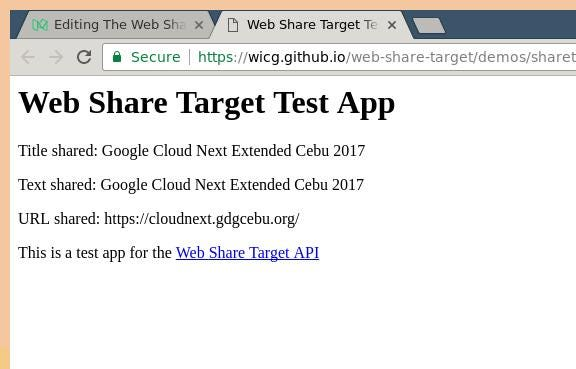

The Web Share API is this new Web API that allows us to share content from our
Web applications using the host platform’s native sharing capabilities. This is
what it looks like in action on one application that I’m building:

<div class="video-embed" style="aspect-ratio: 9 / 16;" >
    <iframe
        width="640"
        height="360"
        title="vimeo-player"
        src="https://player.vimeo.com/video/211609131?h=5a7a253ffc"
        frameborder="0"
        referrerpolicy="strict-origin-when-cross-origin"
        allow="autoplay; fullscreen; picture-in-picture; clipboard-write; encrypted-media; web-share"
        allowfullscreen
    ></iframe>
</div>

<small style="display: block; text-align: center;">
    Web Share API in action
</small>

This feature is really great because we developers don’t have to write a lot of
additional code anymore to handle sharing especially on different social
networks. It also uses a native interface which the user is already familiar
with.

Using the Web Share API is as easy as calling the `navigator.share() function,
which returns a Javacript Promise:

```js
// progressive enhancement, use it only when it is available
if ('share' in navigator) {
    // the object argument to navigator.share() should have at least
    // one of the following keys: title, text, url
    navigator
        .share({
            title: 'The Web Share API',
            text: 'The text that I want to share',
            url: 'https://blog.arnellebalane.com/the-web-share-api',
        })
        .then(() => console.log('Sharing successful'))
        .catch((error) => console.log('Sharing failed'));
}
```

## Feature Support

As of now, the Web Share API is only available in Google Chrome as an
experimental feature, and is hidden behind the “Experimental Web Platform
features” flag. Enabling this flag will allow you to use the Web Share API
(among other features) in your browser, but it would be impractical to ask
every user of your Web applications to enable this flag. Fortunately, as of
Chrome 55, the Web Share API is now available as an Origin Trial. In an Origin
Trial, you get a token which unlocks a specific Web Platform feature only for
the registered origin. You can register for the Web Share API Origin trial
[through this form](https://docs.google.com/forms/d/e/1FAIpQLSfO0_ptFl8r8G0UFhT0xhV17eabG-erUWBDiKSRDTqEZ_9ULQ/closedform).
In my experience, it took less than 24 hours to get my Origin Trial token.

Once you have your token (which will be sent to you via email), all you have to
do is add a meta tag in the pages where you want to use it.

```html
<meta http-equiv="origin-trial" data-feature="Web Share" data-expires="2017-04-05" content="YOUR_TOKEN" />
```

Your Web application needs to be served over HTTPS in order to use the Web
Share API. Additionally, the `navigator.share()` function needs to be invoked
as a result to a user gesture, for example you can call it when the user clicks
on an element, but calling it when the page loads is not allowed.

**Edit: April 5, 2017 10:15PM:** It turns out (just based on observation, no
actual reference yet) that using the Origin Trial does not enable the Web Share
API on desktop browsers. Enabling the “Experimental Web Platform features” flag
does, but then the `navigator.share()` function call will just redirect to a
test page for the Web Share Target API (another cool Web API that we’ll see more
about in the future):

<div class="image-centered">



</div>

<small style="display: block; text-align: center;">
    Web share on desktop redirects to this page
</small>

**Edit: September 13, 2017 12:36PM:** With the recent stable release of Chrome
61, the Web Share API is now enabled by default in Chrome for Android. Yay!
More details [here](https://medium.com/arnelle-balane/the-web-share-api-2cbb3e6cf007).

## Additional Resources

Finally, here are some great resources that are helpful for learning and using
the Web Share API. All the information in this post are based on what I learned
from these resources.

- [Introducing the Web Share API](https://developers.google.com/web/updates/2016/10/navigator-share)
  — a Google Developers article by Paul Kinlan providing an overview of the Web Share API
- [Web Share API Explained](https://github.com/mgiuca/web-share/blob/master/docs/explainer.md)
  — an article explaining the Web Share API user flow and answers several frequently asked questions about it
- [Web Share API Interface](https://github.com/mgiuca/web-share/blob/master/docs/interface.md)
  — a rough spec of the Web Share API, describing its interface, methods and arguments, etc.

## Conclusion

Overall, my (little) experience with the Web Share API has been great and I see
that it really improves the experience of the application users. I look forward
to seeing this API being used more on the Web, as well as using it more myself.
